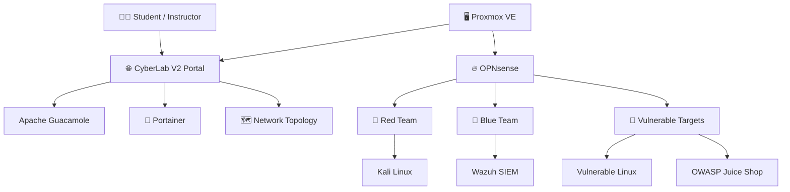

# 🛡️ CyberLab
### Automated Cybersecurity Training & Penetration Testing Platform

**CyberLab** is an open-source, Proxmox-based cybersecurity training platform designed for hands-on education in ethical hacking, network security, threat detection, and incident response.

Deploy complete, isolated cybersecurity environments where students can **attack, defend, investigate, and learn** using real-world security tools.

Built for 🔴 **Red Team**, 🔵 **Blue Team**, and 🟣 **Purple Team** training.

---

## 🚀 Key Features

- 🖥️ **Automated Deployment** – Deploy complete virtual training environments on Proxmox VE.
- 🏗️ **Multi-Lab Support** – Create up to 16 independent labs on a single Proxmox host.
- ⚡ **Flexible Resources** – Big and Mini profiles with configurable CPU, RAM, and disk allocation.
- 🌐 **CyberLab V2 Portal** – A modern browser-based interface for accessing lab systems and tools.
- 🐉 **Offensive Security** – Kali Linux and intentionally vulnerable targets.
- 🛡️ **Defensive Security** – Wazuh SIEM/XDR for monitoring and threat investigation.
- 🐳 **Docker Management** – Portainer integration for managing containers and Docker Compose stacks.
- 🗺️ **Interactive Topology** – Visualize, edit, and save custom network diagrams.
- 📦 **CyberRepo Integration** – Download VM images from a local image server or the internet.
- 🔧 **Modular Architecture** – Add specialized security systems when needed.

---

## 🏗️ Architecture

CyberLab runs on **Proxmox VE**, using Open vSwitch and OPNsense to create segmented virtual networks.



### 🖥️ Core Systems

CyberLab includes four essential systems, with additional virtual machines available during deployment.

| Component | Purpose |
|---|---|
| **OPNsense** | Firewall, routing, and network segmentation |
| **GUACVM** | CyberLab V2 portal, Guacamole, and Portainer |
| **Kali01** | Penetration testing and ethical hacking |
| **VulnSrv01** | Vulnerable Linux training target |

### 🧩 Optional Components

| Component | Purpose |
|---|---|
| **Wazuh** | SIEM, XDR, threat detection, and log analysis |
| **Kali02** | Additional penetration testing workstation |
| **VulnSrv02** | Additional vulnerable Linux target |
| **AppSrv01** | Docker workloads and application security exercises |
| **Client01** | Ubuntu desktop for endpoint security training |
| **T-Pot** | Honeypot and threat intelligence platform |
| **MrNobody** | Automated attack simulation and security exercise platform |

Additional standalone tools and deployment scripts are available in the repository.

**Windows Server 2025** may be integrated separately for Active Directory and Windows security exercises but is not part of the core CyberLab installer.

---

## 🌐 Network Infrastructure

CyberLab uses **Open vSwitch (OVS)** and OPNsense to provide network isolation, routing, and segmentation.

| Network | Subnet | Purpose |
|---|---|---|
| LAN1 | 192.168.1.0/24 | Workstations and attack systems |
| LAN2 | 192.168.2.0/24 | Server and security infrastructure |
| OOBM | 172.20.0.0/24 | Out-of-band management |

Each lab receives dedicated virtual network infrastructure and lab-specific VM names.

---

## 🌍 CyberLab V2 Web Portal

The integrated HTTPS portal provides a central interface for accessing and working with the laboratory environment.

- **Connections** – Browser-based SSH, RDP, VNC, and HTTPS access.
- **Labs** – Portainer-based Docker and container management.
- **Topology** – Interactive network diagram editor with persistent storage.
- **Documentation** – Built-in configuration and usage guides.
- **Settings** – Dedicated area for portal configuration and future enhancements.

All accessible through a standard web browser, without requiring separate remote desktop clients.

---

## ⚡ Automated Deployment

CyberLab provides a menu-driven Bash installer with dynamic hardware calculations and optional VM selection.

```bash
git clone https://github.com/EUD-cyber/eud-cyber.git
cd eud-cyber
bash install.sh
```

### Installation Profiles

- **Big** – Full-size hardware allocation for laboratory systems.
- **Mini** – Reduced hardware allocation for smaller servers.

Both profiles use the same core systems and offer the same optional components.

The installer supports **1–16 labs** and displays estimated total vCPU, RAM, and disk requirements before deployment.

```text
CyberLab Installer
│
├── Select image source
│   ├── Internet
│   └── CyberRepo
│
├── Select storage and network
│
├── Select profile
│   ├── Big
│   └── Mini
│
├── Number of labs (1–16)
│
├── Select optional systems
│
└── Deploy CyberLab
```

Each VM receives a unique lab-based name, such as `lab1-kali01` or `lab2-opnsense`.

Deployment starts with OPNsense, followed by the remaining systems. Existing lab-name conflicts are checked before installation to protect previously deployed environments.

---

## 🎯 Cybersecurity Training

CyberLab supports hands-on security exercises across multiple disciplines.

- 🔴 **Red Team** – Reconnaissance, vulnerability scanning, exploitation, and web security.
- 🔵 **Blue Team** – SIEM monitoring, threat detection, alert investigation, and incident response.
- 🟣 **Purple Team** – Attack simulations, MITRE ATT&CK mapping, and detection validation.
- 🌐 **Network Security** – Firewalls, segmentation, access control, and network analysis.
- 🔐 **Application Security** – OWASP Top 10, insecure configurations, and vulnerable applications.
- 🔎 **SOC Operations** – Log analysis, threat hunting, and security investigations.

The platform enables students to experience both sides of cybersecurity: **how attacks happen and how defenders respond.**

---

## 🧰 Technology Stack

`Proxmox VE` · `KVM/QEMU` · `Open vSwitch` · `OPNsense` · `Kali Linux` · `Wazuh` · `Docker` · `Portainer` · `Apache Guacamole` · `Ubuntu` · `OWASP Juice Shop` · `MrNobody` · `Python` · `Flask` · `Bash`

---

## ⚠️ Disclaimer

CyberLab is intended for **authorized cybersecurity education, research, and testing only**.

The platform contains intentionally vulnerable systems and offensive security tools. All testing must be performed within controlled, isolated environments with appropriate authorization.

---

### 🛡️ CyberLab — Learn. Attack. Detect. Defend.
