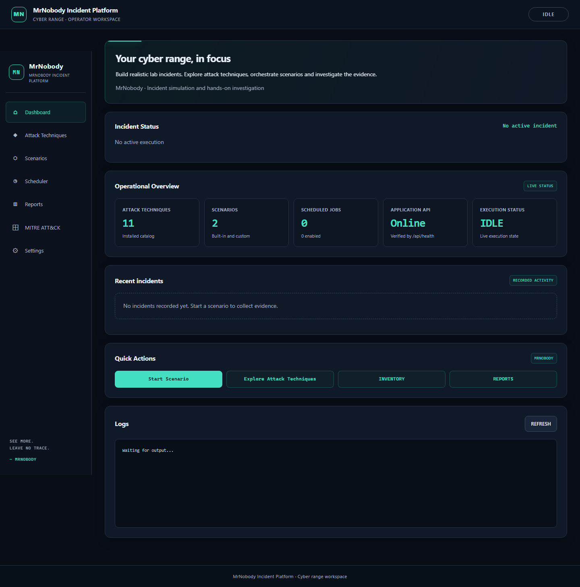
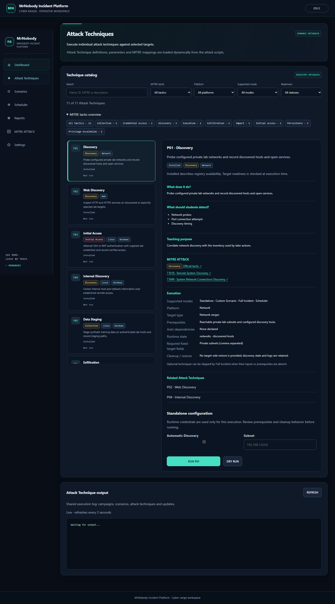
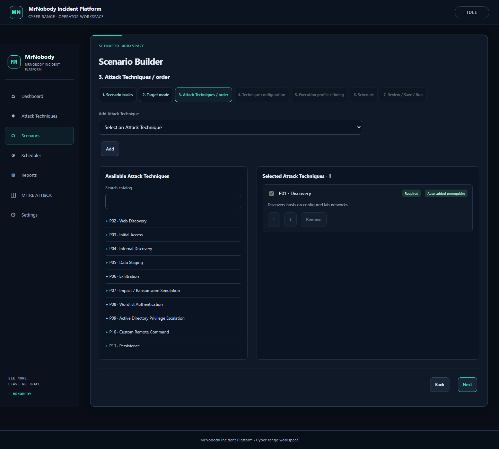

# MrNobody UI redesign

The operator workspace uses a shared navy/teal visual system, compact technical labels, semantic controls and responsive panels. All product labels are English; the visible term is **Attack Techniques**. Existing `phases` API paths, registry IDs, report schemas and scenario definitions remain compatible.

## Navigation and existing tools

The main navigation is Dashboard → Attack Techniques → Scenarios → Scheduler → Reports → MITRE ATT&CK → Settings. Scheduler stays immediately after Scenarios. Scenario Builder and Full Incident configuration are reached from Scenarios. Existing inventory/runtime state is reached from Settings or the Dashboard shortcut. No execution, scheduler persistence or lock implementation was changed.

Dashboard counts and recent incidents come from the existing APIs. Health means an actual `/api/health` response; it does not claim Nginx, TLS or lab-target monitoring. Execution summaries retain the live overview and latest execution/report links. Polling is bounded and failed requests display unavailable states.

## Registry and historical data

Each installed script now owns educational `ATTACK_*` comments for description, teaching purpose, detection focus, platforms, prerequisites, target type and cleanup. These comments are read by the existing metadata parser and exposed additively as `education` on `/api/phases`. The `technique_metadata()` projection in `scenario_model.py` derives configuration, dependencies and required fields from planning capabilities, Standalone/Scheduler support from executable capabilities, and Full Incident membership from its installed scenario definition. Existing fields are preserved. Missing future metadata is explicitly unknown rather than copied from a mockup.

Tactics accept both comma and pipe separators used by the registry. Mappings and technique names remain those on `main`. Canonical tactic URLs follow [MITRE Enterprise tactics](https://attack.mitre.org/tactics/enterprise/). Counts describe **implementation / mapping coverage**, not detection effectiveness. A tactic card's associated ATT&CK technique count is the union of mappings on its MrNobody techniques; it is not a measured detection metric or a claim that every mapping has a one-to-one tactic relationship.

Readiness says **Installed**, not unconditional Ready: target prerequisites are evaluated by the existing execution paths. Live execution statuses are separate and remain visible after catalog filtering. Settings exposes existing update controls, API/version information, logs, inventory and Full Incident configuration links. Unsupported integration toggles, backup buttons, detection percentages and invented scenario presets are omitted.

`/api/scenarios` also exposes the existing default execution profile and real total/enabled schedule counts. Custom scenarios remain visible if the built-in scenario directory is absent.

Report lists add recorded technique names/statuses from saved report snapshots. Historical report JSON is not rewritten. Investigation/Ground Truth, canonical timeline, evidence, assets, ATT&CK links, HTML/PDF exports and raw JSON remain supported.

## Distribution

Only existing distributed runtime files changed, including script metadata comments. `update-manifest.txt` is regenerated for their exact bytes. No runtime file or asset was added, so `MRNOBODY/mrnobody_userdata.yaml` and cloud-init remain unchanged. No schema migration, deployment or VM operation is included.

## Validation

- Existing Python backend, install, planning, remote actions, P09–P18, execution overview, reports and export suites run with isolated fixtures.
- Existing JavaScript builder, scenario, live-log, report, P10 dual-command and execution overview suites retain behavior checks; expected visible terminology/navigation is updated.
- `python tests/mrnobody/ui.py` verifies additive metadata against actual installed scripts, supported modes, mappings, read-only APIs, historical list metadata, semantic HTML and backed Settings controls.
- `node tests/mrnobody/ui_browser.cjs` uses Playwright and `ui_server.py`, which binds an ephemeral loopback port, blocks all mutation requests, disables process launch and never starts the scheduler. It verifies real registry search/filter/detail, safe text rendering, MITRE navigation, builder dependencies, scheduler/report/settings shells and layouts at 1440/1024/768/390px. Install Playwright 1.62.1 and Chromium first; `MRN_TEST_PYTHON` can select Python. `MRN_UI_ARTIFACTS` optionally saves page screenshots.
- GitHub validation also runs Linux Bash checks and uploads desktop/mobile screenshots. Windows-local Bash-specific fixtures retain their existing skips.

The referenced chat exposed the approved design description but no mockup image attachment. The implementation follows the specified visual direction rather than claiming a pixel match to an unavailable image.

## Local read-only previews

These screenshots use the real installed catalog with no incidents or schedules executed.

